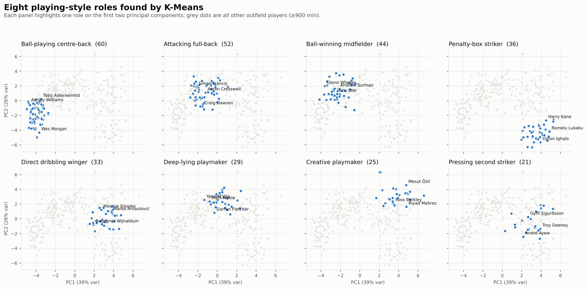
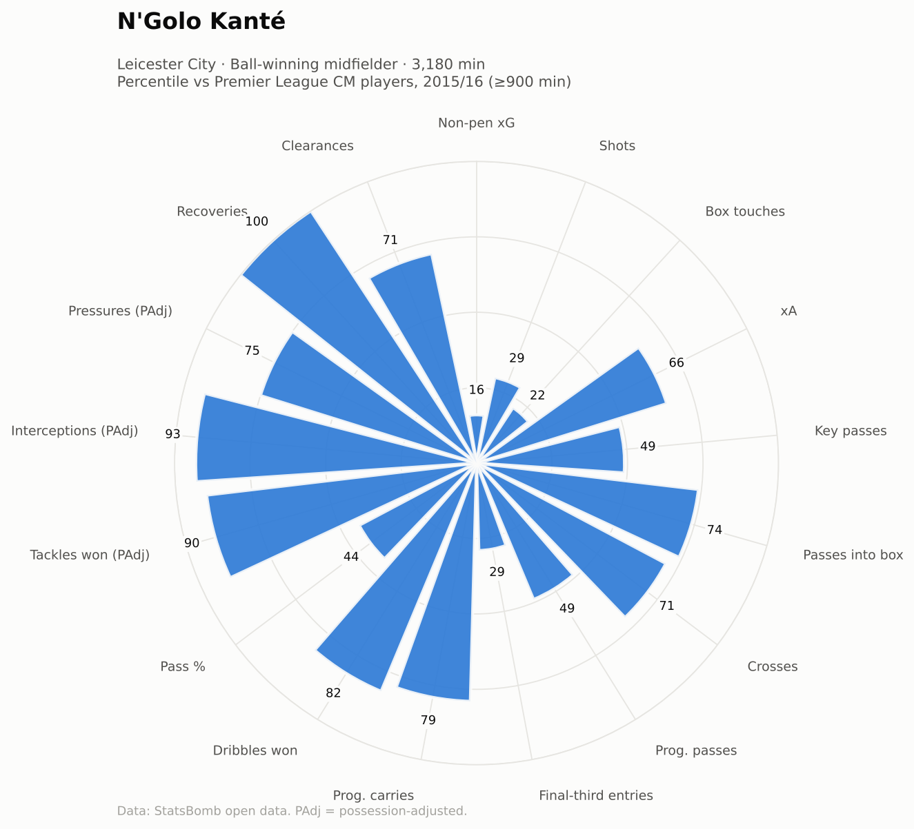

# Player Scouting & Similarity Engine ⚽

Find players who play the same **way** — not just score the same — using event data from every
match of the 2015/16 Premier League (StatsBomb open data, ~1.3M events, 380 matches).

> *"Who plays like N'Golo Kanté?"* → Idrissa Gueye (96.5), Mousa Dembélé (93.7), Jack Cork (93.3)…
> found from event data alone, with no position labels or reputation in the model.



## What it does

| Step | Method | Output |
|---|---|---|
| Data | Downloads + caches StatsBomb JSON, flattens to parquet | `data/processed/events_2_27.parquet` |
| Features | 30 per-90 metrics: npxG, xA, progressive passes/carries, possession-adjusted tackles / interceptions / pressures… | `player_features_epl_2015_16.csv` |
| Roles | log1p → z-score → PCA (6 PCs, 86% var) → K-Means (k=8) | `outputs/player_roles.csv`, `role_summary.csv` |
| Similarity | Cosine similarity in PCA space, filters for position / other clubs / minutes | `model.similar("Kanté")` |
| Validation | Half-season self re-identification test | `outputs/metrics.json` |
| Visuals | Percentile pizzas, comparison radars, role map | `outputs/figures/` |
| Explorer | Self-contained interactive HTML: search any player, live filters, radar overlay, style map | `outputs/scout_room.html` |

## Results

**Eight playing-style roles** emerged and were named from their defining traits:

| Role | Players | Defining traits | Examples |
|---|---|---|---|
| Ball-playing centre-back | 60 | Clearances, long passes, interceptions | Alderweireld, Morgan, Huth |
| Attacking full-back | 52 | Crosses, progressive passes | Cresswell, Monreal, Bellerín |
| Ball-winning midfielder | 44 | Tackles, interceptions, pressures (PAdj) | Kanté, Gueye, Dier |
| Penalty-box striker | 36 | npxG, box touches, shots | Kane, Vardy, Lukaku |
| Direct dribbling winger | 33 | Progressive carries, dribbles | Mané, Zaha, Martial |
| Deep-lying playmaker | 29 | Final-third entries, recoveries, passing volume | Noble, Drinkwater, M'Vila |
| Creative playmaker | 25 | xA, passes into box, through balls | Özil, Eriksen, Silva |
| Pressing second striker | 21 | High pressures, box touches | Alli, Deeney, Sigurðsson |

**Validation — does it capture a stable style?** Split the season at 2 Jan 2016, fit the scaler + PCA on the
first half only, then rank every second-half profile by similarity to each player's first-half profile.

| Metric (203 players, 264 candidates) | Model | Position only | Random |
|---|---|---|---|
| Own profile is #1 match | **28%** | — | 0.4% |
| Own profile in top 5 | **61%** | 12% | 1.9% |
| Median rank of own profile | **3** | — | 132 |

Players re-identify themselves ~30× more often than chance and ~5× more than position alone, so the
features describe individual style rather than noise.

**Why k = 8?** Silhouette is highest at k=4 (CB / FB / midfield / attack — accurate but useless for
recruitment). k=8 gives roles a scout recognises at modest cost in compactness. Playing style is a
continuum, so the similarity search works on distances, not cluster boundaries.



## Run it

```bash
git clone https://github.com/<your-username>/football-scouting.git
cd football-scouting
python -m venv .venv && source .venv/bin/activate   # Windows: .venv\Scripts\activate
pip install -r requirements.txt
python run.py                      # ~40s first run (downloads data), ~15s after
jupyter notebook notebooks/scouting_analysis.ipynb
```

Raw event data (~130 MB) is downloaded on first run and git-ignored, so the repo itself stays small.

**Interactive explorer:** open `outputs/scout_room.html` in a browser. GitHub shows HTML files as source code,
so to share a live link, turn on GitHub Pages (Settings → Pages → deploy from `main`) and visit
`https://<your-username>.github.io/football-scouting/outputs/scout_room.html`.

```python
from src.similarity import ScoutingModel
import pandas as pd
model = ScoutingModel().fit(pd.read_csv("data/processed/player_features_epl_2015_16.csv", index_col=0))
model.similar("Riyad Mahrez", n=8, other_teams=True)   # replacement shortlist
model.profile("Mesut Özil")                             # percentiles vs position group
```

Any other StatsBomb competition works: `load_events(competition_id, season_id)` (e.g. La Liga 2015/16 = `11, 27`).

## Project structure

```
src/data.py        download, cache, flatten events; player nicknames
src/features.py    minutes played, per-90 & possession-adjusted features
src/similarity.py  ScoutingModel: PCA, K-Means roles, similarity, percentiles
src/evaluate.py    half-season re-identification validation
src/viz.py         pizza, comparison radar, role map, diagnostics
explorer/          HTML template + build script for the interactive Scout Room
run.py             end-to-end pipeline
notebooks/         narrated, executed analysis
outputs/           CSVs, metrics, figures, explorer_data.json
```

## Design decisions

- **Possession adjustment.** Raw tackle counts reward defenders in bad teams (more defending to do).
  Tackles, interceptions and pressures are scaled by `0.5 / opponent possession` per match.
- **log1p before scaling.** Per-90 counts are right-skewed; logging stops a few extreme players dominating the PCA.
- **PCA before distance.** Shots, npxG and box touches all measure the same thing; PCA removes that
  redundancy so it isn't triple-counted in the similarity.
- **Cosine, not Euclidean.** Cosine compares the *shape* of a profile, so a player with the same style at
  lower volume still matches.
- **Percentiles within position group.** A centre-back's 60th-percentile passing is judged against centre-backs.

## Limitations

- One league, one season (2015/16); minutes threshold 900.
- Event data misses off-ball movement — tracking data would add runs, spacing and defensive positioning.
- Primary position is the event-weighted mode, so hybrid players are simplified.
- Goalkeepers are excluded (they need their own feature set).

## Next steps

- Add age, contract and market value to turn similarity into a costed shortlist.
- Let the user weight features (a club may care about pressing over aerials).
- Compare across seasons/leagues with league-strength adjustment.
- Learn embeddings from action sequences (e.g. autoencoder / player2vec).

---
Data: [StatsBomb Open Data](https://github.com/statsbomb/open-data) — free for non-commercial use with attribution.
